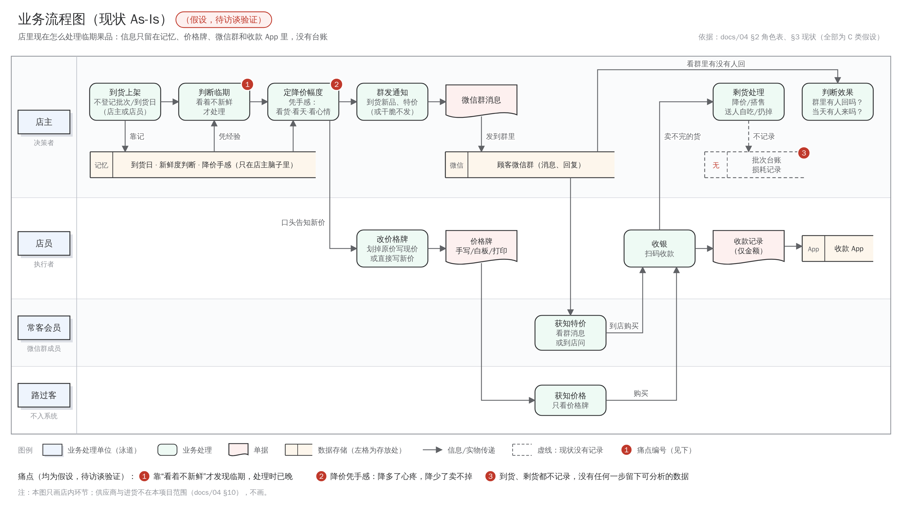
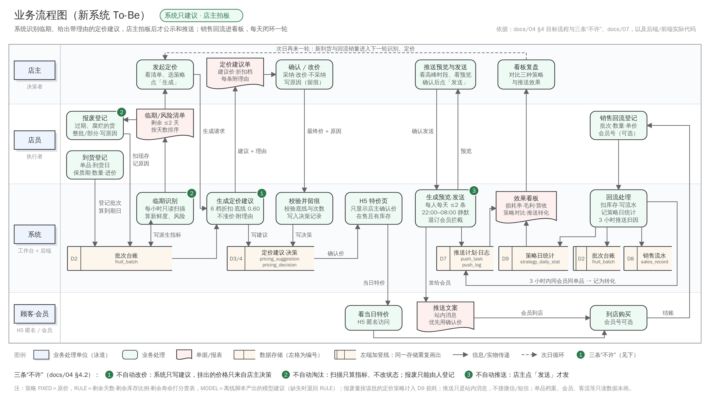
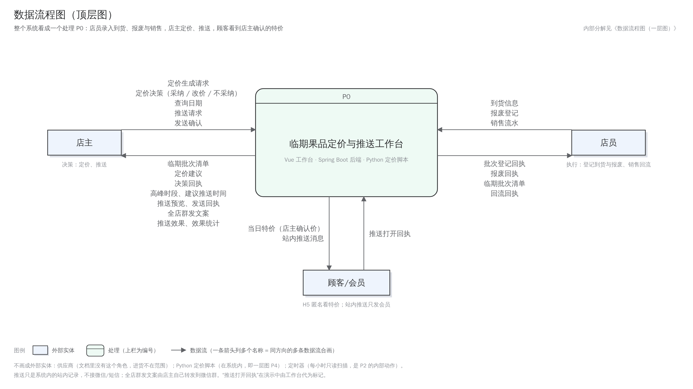
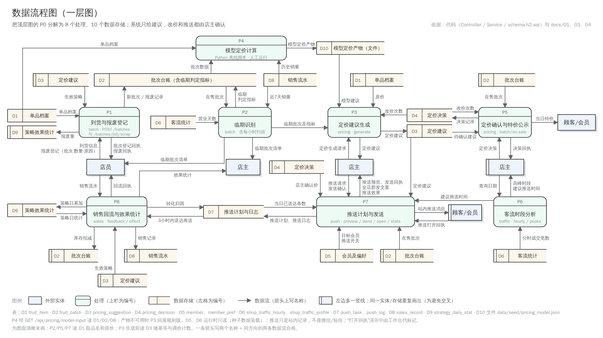
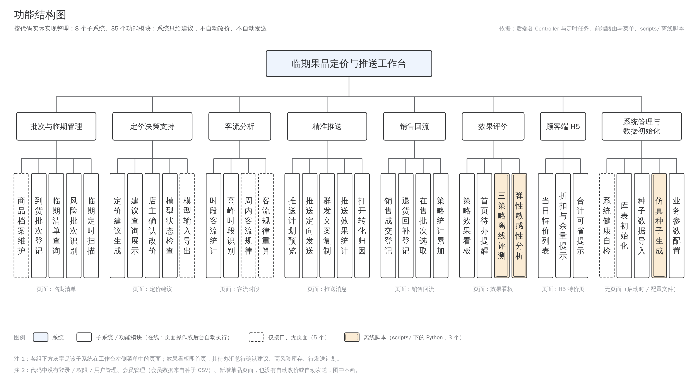
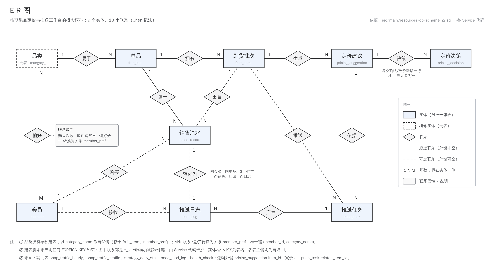

# 系统分析与设计（按管理信息系统开发方法整理）

> 本文按管理信息系统教材（薛华成《管理信息系统》）的生命周期组织：**系统规划 → 系统分析 → 系统设计 → 系统实施 → 系统评价**，
> 把散在 `docs/01~07`、代码和评测报告里的内容整理成教材要求的图表，供答辩 PPT 直接取用。
> 所有图表都照**代码实际情况**画（表名、接口、页面都能在仓库里找到）；文档与代码不一致的地方以代码为准，并在第 7 节列出。
> 图由 `scripts/mis/*.py` 生成（只用标准库，输出 SVG），PNG 用 `scripts/mis/render_png.mjs` 渲染；改图请改脚本后重新生成。

---

## 0. 答辩怎么用这份文档

| PPT 页 | 用本文的哪部分 | 一句话讲法 |
| --- | --- | --- |
| 问题与现状 | 图 1 现状业务流程图 + 三个痛点 | 店里没有台账：临期靠眼看、降价靠手感、卖没卖完不记录 |
| 系统定位 | 第 1 节（DSS 与 Simon 决策四阶段） | 半结构化决策：系统给候选价和理由，店主拍板 |
| 新流程 | 图 2 新系统业务流程图 | 每一步都留下数据，最后回到看板形成闭环 |
| 数据与处理 | 图 3a 顶层数据流程图（一层图 3b 放备用页）+ 表 4 定价决策表 | 数据从哪来、到哪去；规则写成可复核的决策表 |
| 系统设计 | 图 4 功能结构图、图 5 E-R 图 + 关系模式 | 8 个子系统；14 张表，M:N 偏好转成独立关系 |
| 评价 | 第 6 节 + `release/figs/eval_tradeoff.png` | 同样的损耗率，模型定价比经验取舍平均多赚 4,141 元 |

---

## 1. 系统规划：这是一个决策支持系统（DSS）

临期果品"降多少、什么时候降、告诉谁"是**半结构化决策**：剩余天数、库存可以量化，但客流、天气、店主对毛利的取舍无法完全量化。
所以系统定位为**决策支持**而不是自动化：系统负责算和记，**定价权在店主**。对应西蒙（Simon）决策过程的四个阶段：

| 决策阶段 | 本系统里对应什么 | 实现 |
| --- | --- | --- |
| 情报（发现问题） | 临期识别：哪些批次快到期、哪些预计卖不完 | 每小时只读扫描 + `GET /api/batches/near-expiry`、`/at-risk` |
| 设计（拟定方案） | 在 6 个候选折扣档里给出建议价 + 人话理由 | `POST /api/pricing/suggestions/generate`（FIXED / RULE / MODEL 三种策略） |
| 选择（拍板） | 店主采纳、改价或不处理，每次决策都留痕 | `POST /api/pricing/decisions` → `pricing_decision` |
| 实施（执行与反馈） | H5 公示确认价、推送、销售回流、效果看板 | `/api/batches/on-sale`、`/api/push/*`、`/api/sales/feedback`、`/api/sales/effect` |

配套的三条"不许"（`docs/04` §4.2）：**不自动改价、不自动淘汰、不自动推送**。全系统唯一的定时任务是只读扫描，只写临期判定指标。

---

## 2. 系统分析

### 2.1 业务流程分析

**图 1 现状业务流程图（As-Is）**——内容来自 `docs/04` §2–§3，全部是**待访谈验证的假设**，图上已标注。

**图 2 新系统业务流程图（To-Be）**

新旧流程逐环节对比：

| 环节 | 现状 | 新系统 | 新留下的数据 |
| --- | --- | --- | --- |
| 到货 | 不登记 | 店员录到货，系统算到期日、生成批次号 | `fruit_batch` |
| 判断临期 | 看着不新鲜才处理 | 按剩余天数筛临期批次，并算预计卖不完的量 | 临期判定指标（新鲜度、预计可售天数、预计报废） |
| 定价 | 凭手感 | 系统给候选价 + 理由，店主确认或改价 | `pricing_suggestion`、`pricing_decision` |
| 告诉顾客 | 改价签、微信群 | H5 特价页（只显示店主确认价）+ 站内推送 + 群发文案 | `push_task`、`push_log` |
| 收银 | 只记金额 | 销售回流：扣批次库存、记入策略统计、判断是否推送带来 | `sales_record`、`strategy_daily_stat` |
| 剩货处理 | 扔掉或送人，不记录 | 店员在临期清单上登记报废（整批或部分，原因必填）；整批报废的批次移出清单，报废量计入定价策略的当日损耗 | `fruit_batch.scrap_qty` 与登记留痕、`strategy_daily_stat.scrap_qty` |
| 判断效果 | 看群里有没有人回 | 效果看板：毛利、损耗率、售出率按策略对比 | 看板读上面所有数据 |

### 2.2 数据流程分析

**图 3a 数据流程图（顶层图）**——把整个系统看成一个处理 P0，只画与三个外部实体之间的数据流。

**图 3b 数据流程图（一层图）**——P0 分解成 8 个处理、10 个数据存储；与顶层图的数据流一一平衡（名称相同）。
为避免连线交叉，同一外部实体或数据存储会重复画出，左边多一条竖线表示"重复画出"（教材的标准画法）。
答辩 PPT 建议正文放顶层图、一层图放备用页，被问到"数据从哪来"时再翻出来。

- **外部实体**：店主、店员、顾客/会员。供应商不在本项目范围（`docs/04` §10）。
- **处理**：P1 到货与报废登记、P2 临期识别、P3 定价建议生成、P4 模型定价计算（Python 离线脚本）、P5 定价确认与特价公示、
  P6 客流时段分析、P7 推送计划与发送、P8 销售回流与效果统计。
- **数据存储**与库表的对应：

| 编号 | 数据存储 | 库表 / 文件 |
| --- | --- | --- |
| D1 | 单品档案 | `fruit_item` |
| D2 | 批次台账 | `fruit_batch`（含临期判定派生列） |
| D3 | 定价建议 | `pricing_suggestion` |
| D4 | 定价决策 | `pricing_decision` |
| D5 | 会员及偏好 | `member`、`member_pref` |
| D6 | 客流统计 | `shop_traffic_hourly`、`shop_traffic_profile` |
| D7 | 推送计划与日志 | `push_task`、`push_log` |
| D8 | 销售流水 | `sales_record` |
| D9 | 策略效果统计 | `strategy_daily_stat` |
| D10 | 模型定价产物 | 文件 `data/seed/pricing_model.json` |

- **Python 定价模块放在系统边界内**（P4）：它经 `GET /api/pricing/model-input` 读快照、写产物文件 D10，后端 MODEL 策略再读 D10。
  按 DFD 规则外部实体不能直接写数据存储，所以它是处理而不是外部实体。
- D5、D6 在运行时没有写入处理，由演示数据装载写入；推送只记在系统内（`push_log`），没有接真实微信/短信。
- P2 算日均销量时以 D6 里"有客流记录的天数"作分母（闭店日不计），所以 D6 → P2 有一条"营业天数"数据流。

### 2.3 处理逻辑：定价决策表

三种策略共用同一组候选档 `{1.00, 0.90, 0.80, 0.70, 0.60, 0.50}`（价格比，1.00 = 原价），都不涨价。
**系统里的 FIXED / RULE 与离线评测是同一套规则**：以 `scripts/pricing_rule.py` 为准，后端逐条照搬，
契约测试用 1080 个边界用例逐条比对，只改一边 CI 就会失败（`docs/03` §2.1）。

**表 1 FIXED（基线 1，代表"店主不降价"的现状）**：任何情况都维持原价。

**表 2 RULE（基线 2，店主经验）——第一步：三项打分**

| 条件 | 取值 → 分数 |
| --- | --- |
| C1 紧迫度：剩余天数 d | d ≤ 0 → 4；d = 1 → 3；d = 2 → 2；d = 3 → 1；d ≥ 4 → 0 |
| C2 库存压力：现存 ÷ 到货量（只在 d ≤ 3 时计入；拿不到到货量时按 20 份满仓折算） | ≥ 70% → 3；≥ 50% → 2；≥ 30% → 1；其余 → 0 |
| C3 剩余寿命：d ÷ 保质期 | ≤ 20% → 加 1 分；否则 0 |

**表 3 RULE——第二步：总分查表**

| 总分（C1 + C2 + C3） | 0 | 1 | 2 | 3 | 4 | 5 | 6 | 7 | 8 |
| --- | --- | --- | --- | --- | --- | --- | --- | --- | --- |
| 折扣档 | 原价 | 9 折 | 9 折 | 8 折 | 7 折 | 7 折 | 6 折 | 5 折 | 5 折 |

**表 4 RULE 决策表（含护栏与约束，按教材的条件桩 / 动作桩写法）**

规则按列读：每一列是一条规则，"—"表示该条件不影响这条规则。

| | | R1 | R2 | R3 | R4 | R5 |
| --- | --- | --- | --- | --- | --- | --- |
| **条件桩** | 现存 > 0 | N | Y | Y | Y | Y |
| | 刚到货（d ≥ 保质期 且 d > 3） | — | Y | N | N | N |
| | 最后可售日（d ≤ 1）且查表结果浅于 7 折 | — | — | Y | N | N |
| | 结果低于最低折扣线 0.60 | — | — | — | Y | N |
| **动作桩** | 原价（不需要定价） | ✓ | ✓ | | | |
| | 至少打到 7 折 | | | ✓ | | |
| | 抬到 6 折，并记"本可以更低到 X 折" | | | | ✓ | |
| | 按表 3 查表结果出价 | | | | | ✓ |

所有规则共有的动作：建议价 = 原价 × 折扣（两位小数，不高于原价）；理由写明各项得分；建议价低于批次成本时注明"属清仓让利"；
同一批次每天最多调价 2 次（生成一条建议算 1 次，店主改成与建议不同的价算 1 次），第 3 次被拒绝并说明原因。

典型情形（与 `pricing_rule.py --selftest`、`PricingPolicyTest` 中的用例一致）：

| 剩余天数 | 现存 / 到货 | 保质期 | 得分 | 结果 |
| --- | --- | --- | --- | --- |
| 7 | 40 / 40 | 7 | 刚到货 | 原价 |
| 3 | 38 / 40 | 7 | 1 + 3 = 4 | 7 折 |
| 2 | 10 / 40（剩 25%） | 7 | 2 + 0 = 2 | 9 折 |
| 2 | 35 / 40 | 7 | 2 + 3 = 5 | 7 折 |
| 1 | 5 / 40 | 7 | 3 + 0 = 3（8 折，最后可售日护栏） | 7 折 |
| 0 | 20 / 40 | 7 | 4 + 2 + 1 = 7 | 5 折 → 被最低折扣线抬到 6 折 |

**MODEL（本项目方案）与 RULE 的区别**：价格不靠查表，而是由 Python 从历史销售估计每个单品的价格弹性，
在候选档里用有限期动态规划选"含报废成本的期望收益"最大的一档（`docs/03` §3）。
产物缺失、过期、模型不可用、最低折扣线不一致或没覆盖到某批次时，**如实回退到 RULE**，理由里写明原因，并记 `effective_strategy = RULE`。

---

## 3. 系统设计

### 3.1 功能结构设计

**图 4 功能结构图**

8 个子系统：批次与临期管理、定价决策支持、客流分析、精准推送、销售回流、效果评价、顾客端 H5、系统管理与数据初始化。
每个功能模块都对应真实的接口或页面（对照表见 `docs/01` §5 接口清单）。

### 3.2 系统物理配置

| 层 | 组成 | 说明 |
| --- | --- | --- |
| 客户端 | 浏览器：Vue 3 + Element Plus 工作台（7 个页面）；手机：H5 特价页 `#/h5` | 工作台给店主、店员用；H5 给顾客看，不收集个人信息 |
| 应用服务器 | Spring Boot 3.5（REST 接口 `/api/*`，端口 8080） | 唯一的定时任务是每小时只读临期扫描 |
| 数据库 | 演示：H2（MySQL 兼容模式，零安装）；部署：MySQL 8（`mysql` profile） | 两套建表脚本字段一致；重启不清空数据（`app.db.keep-existing`） |
| 离线计算 | Python 3：模型定价、三策略评测、敏感性分析、仿真种子生成 | 模型产物以 JSON 文件交给后端 |
| 质量保障 | GitHub Actions：H2、MySQL 8.0、MySQL 8.4 后端测试，前端构建，Python 自检 | 每次推送都跑 |

### 3.3 代码设计

| 代码 | 结构 | 示例 | 生成位置 |
| --- | --- | --- | --- |
| 单品编码 `item_code` | `F` + 1 位大类号 + 3 位顺序号（1 仁果、2 柑橘、3 浆果、4 核果、5 热带、6 瓜类、7 葡萄提子） | F1001 红富士苹果、F3001 丹东红颜草莓 | 仿真器种子数据；新增单品时由调用方提供，按编码幂等 |
| 批次号 `batch_no`（系统登记） | `B` + 到货日 yyyyMMdd + `-` + 单品 id 补零到 4 位 + `-` + 2 位当日序号 | B20350101-0007-01 | `BatchService.nextBatchNo`；也可手工指定（≤ 32 位、不重复） |
| 批次号 `batch_no`（种子数据） | `B` + 到货日 + `-` + 单品编码 + `-` + 4 位全局到货序号 | B20260302-F1001-0000 | `scripts/simulator.py` |
| 会员号 `member_no` | `M` + 4 位顺序号 | M0001 ~ M0120 | 种子数据 |
| 业务流水号 `request_no` | `WEB-` + UUID（销售回流的幂等键） | WEB-3f2c9a1e-… | 销售回流页；超时重试沿用同一号，表单一改就换新号 |
| 状态与分类码 | 批次 ON_SALE / SOLD_OUT / SCRAPPED；策略 FIXED / RULE / MODEL；推送渠道 IN_APP / GROUP_TEXT；推送计划 PLANNED / SENT / CANCELLED；跳过原因 限频 / 静默 / 退订；数据来源 REAL / SIM | — | 写死在代码常量里 |

批次号有两种格式并存：种子数据中间段是单品编码，系统登记中间段是单品 id。两者都唯一，系统不解析批次号的含义。

### 3.4 数据库设计

**图 5 E-R 图**

**E-R 图到关系模式的转换**：1:N 联系把"1"端的主键放进"N"端作外键；会员与品类的 M:N "偏好"联系转换成独立关系 `member_pref`，
联系的属性（购买次数、最近购买日、偏好分）成为它的列。品类没有单独建表，以 `category_name` 作自然键。
两份建表脚本都没有声明 FOREIGN KEY 约束，外键是逻辑外键，由 `*_id` 列和服务层代码维持。

**关系模式**（主键加下划线，外键标 *斜体*）：

| 关系 | 关系模式（主要属性） | 唯一约束 |
| --- | --- | --- |
| 单品 | fruit_item(<u>id</u>, item_code, item_name, category_name, unit, cost_price, base_price, shelf_life_days, status) | item_code |
| 到货批次 | fruit_batch(<u>id</u>, *item_id*, batch_no, arrive_date, expire_date, init_qty, remain_qty, scrap_qty, cost_price, status, freshness, at_risk, …, scrapped_at, scrap_reason, scrap_operator) | batch_no |
| 定价建议 | pricing_suggestion(<u>id</u>, *item_id*, *batch_id*, biz_date, days_left, remain_qty, original_price, suggested_price, discount_rate, strategy, effective_strategy, adjust_seq, price_floor_hit, reason) | — |
| 定价决策 | pricing_decision(<u>id</u>, *suggestion_id*, suggested_price, final_price, accepted, operator, reason, reject_reason, decided_at) | — |
| 会员 | member(<u>id</u>, member_no, nickname, phone_tail, joined_date, push_enabled) | member_no |
| 会员偏好 | member_pref(<u>id</u>, *member_id*, category_name, buy_count, last_buy_date, score) | (member_id, category_name) |
| 时段客流 | shop_traffic_hourly(<u>id</u>, stat_date, hour_of_day, order_count, customer_count, is_peak) | (stat_date, hour_of_day) |
| 周内客流规律 | shop_traffic_profile(<u>id</u>, weekday, hour_of_day, avg_order_count, avg_customer_count, sample_days, is_peak, computed_at) | (weekday, hour_of_day) |
| 推送任务 | push_task(<u>id</u>, *related_item_id*, *related_batch_id*, *related_suggestion_id*, biz_date, channel, plan_time, audience_rule, target_count, title, content, status, discount_rate) | — |
| 推送日志 | push_log(<u>id</u>, *task_id*, *member_id*, sent_at, opened, opened_at, converted, converted_at, convert_window_hours, *related_sale_id*, skip_reason) | — |
| 销售流水 | sales_record(<u>id</u>, *item_id*, *batch_id*, *member_id*, biz_date, sale_time, quantity, unit_price, is_discount, is_return, source, request_no, requested_qty) | request_no |
| 策略日统计 | strategy_daily_stat(<u>id</u>, biz_date, strategy, sold_qty, scrap_qty, revenue, cost, gross_profit, scrap_rate, stockout_rate) | (biz_date, strategy) |
| 种子导入标记 | seed_load_log(<u>id</u>, seed_name, row_count, loaded_at) | — |
| 自检表 | health_check(<u>id</u>, check_name, status, checked_at) | — |

字段类型、默认值和全部列见 `src/main/resources/db/schema-h2.sql`（MySQL 版 `schema-mysql.sql` 字段一致）与 `docs/02` §5。

### 3.5 输入设计

原则：**能由系统算的不让人填**（到期日、批次号、默认成交价都自动带出），**能在界面上拦的先拦**，后端再校验一遍。
所有错误统一返回 400 / 404 / 409 和一句人话原因。

| 输入 | 关键字段与校验 | 防错措施 |
| --- | --- | --- |
| 到货登记 `POST /api/batches` | 单品必须存在；到货日必填；数量 ≥ 0.01；保质期、进货价不填就取单品档案 | 到期日 = 到货日 + 保质期，由系统算；批次号自动生成、唯一 |
| 店主决策 `POST /api/pricing/decisions` | 建议必须存在（否则 404）；已被重新生成替换的旧建议返回 409；最终价 ≥ 0.01 | 低于最低折扣线返回 400 并告知"本单最低可售 ¥X"；改价计入每日调价次数；不采纳时必须留下原因；已决策的行按钮置灰 |
| 推送预览 / 发送 `POST /api/push/preview`、`/send` | 单品必选；折扣 0.5–1.0；人数 1–200 | 有店主确认价时一律用确认价；发送用预览返回的 taskId，输入一改旧预览作废，防止"预览 A、发出 B"；每人每天最多 2 条、22:00–08:00 静默、退订会员拦下并记原因 |
| 销售回流 `POST /api/sales/feedback` | 营业日必填；单品与批次至少一个、且互相匹配；数量按两位小数不能为 0；成交价 ≥ 0 | 成交价默认填店主当天确认价；超卖只扣现存并明确提示；**退货必须指定原批次**（前后端都校验）；流水号 `requestNo` 幂等：同号同内容只记一次，同号不同内容返回 409 |
| 报废登记 `POST /api/batches/{id}/scrap` | 营业日必填；数量不填 = 整批，填了必须 > 0 且不超过现存；原因必填 | 原因可选常用项或自己写；已无现存的批次不能再登记；被拒的请求不改任何数据；登记时间、原因、登记人留痕 |
| 新增单品 `POST /api/items`（只有接口） | 编码、名称、品类必填；原价 ≥ 0.01、成本 ≥ 0 | 按编码幂等：有则更新、无则新增 |

### 3.6 输出设计

| 输出 | 载体 | 内容 | 使用者 |
| --- | --- | --- | --- |
| 定价建议 + 理由 | 定价页表格、确认对话框 | 建议价、折扣、实际生效策略（回退时标出）、期望销量、逐项打分的理由 | 店主决策，店员照价执行 |
| 临期 / 风险清单 | 临期清单页 | 到期日、剩余天数、新鲜度、预计可售天数、预计报废 | 店主、店员 |
| 效果看板 | 看板页 | 区间毛利、损耗率、售出、缺货率；三策略对比条形图；每日趋势；待办入口 | 店主 |
| 推送文案 / 群发文案 | 推送页 | 店名、单品、原价与确认价、剩余天数、建议到店时段；送达、打开、转化与被拦下数 | 店主发送；会员收站内消息；群发文案由店主自己转发 |
| H5 特价页 | 手机页 `#/h5` | 店主确认价、原价、折扣、余量、合计可省 | 顾客 |
| 评测报告 | `release/evaluation-report.md` 与图表 | 三策略对比、统计检验、敏感性、假设边界与局限 | 指导老师、答辩评委 |

### 3.7 安全性与可靠性设计

| 风险 | 措施 |
| --- | --- |
| 并发销售把库存扣错 | 批次行加锁（`SELECT … FOR UPDATE`），统计用单条 upsert，销售事务用"读已提交" |
| 网络超时重复提交 | 业务流水号 + 唯一索引，重复提交原样返回首笔结果 |
| 价格乱跳、贱卖 | 最低折扣线 0.60、每批次每天最多调价 2 次，对三种策略和店主手工改价同样生效 |
| 系统越权替人决策 | 三条"不许"：不自动改价、不自动淘汰、不自动推送；报废只能由人登记；所有决策和报废都留痕（操作人、原因、时间） |
| 打扰顾客、个人信息 | 推送限频、静默时段、退订；只存手机尾号；H5 不收集任何个人信息（`docs/05`） |
| 重启丢数据 | `app.db.keep-existing`：已有表结构时不重建，只补列和索引 |
| 评测与系统口径不一致 | FIXED / RULE 的契约测试；MODEL 读带元数据的产物，不合格就如实回退 |
| 未做 | 登录与权限（Issue #5）——当前所有人打开工作台都能操作，答辩时如实说明 |

---

## 4. 系统实施与测试

- **测试**：后端 161 个自动化测试，在 H2、MySQL 8.0、MySQL 8.4 上由 CI 每次推送运行；Python 脚本各自带自检。
- **契约测试**：定价规则 1080 个边界用例两边逐条比对；模型产物的读写格式也有契约夹具。
- **端到端**：`frontend/scripts/screenshot.mjs` 起真后端和前端构建产物，逐页操作并截图，检查控制台报错与失败请求（7 个页面）。
- **测试有效性**：关键测试都在修复前的代码或人为注入错误的代码上确认过"会失败"。

---

## 5. 系统评价

评测在仿真器上进行：同一批消费者、同一初始库存、同一补货量，只换定价函数（公共随机数），20 个随机种子（`release/evaluation-report.md`）。

| 策略 | 经营毛利 / 元 | 损耗率 | 售出率 |
| --- | --- | --- | --- |
| FIXED（不降价） | 68,370 | 13.58% | 82.83% |
| RULE（店主经验） | 49,861 | 4.99% | 95.02% |
| **MODEL（本项目）** | **60,194** | 7.84% | 89.97% |

- **经济效益**：降损耗都要付毛利代价（连"只在到期当天打 9 折"也是 −1.2%），所以比较的是"每降 1 个百分点损耗花多少钱"：
  RULE 2,155 元，MODEL 1,424 元，便宜约 34%；MODEL 对 RULE 20/20 个种子毛利更高，平均多 10,333 元。
  把 FIXED 和 RULE 连成"凭经验取舍"的直线，同样的损耗率下 MODEL 平均高出 4,141 元（20/20 个种子都在线上方，见 `release/figs/eval_tradeoff.png`）。
  弹性整体 ±30% 时，MODEL 对 RULE 三档都是 6/6 胜。
- **管理效益**：从"没有任何一步留下可分析的数据"变成到货、定价、决策、推送、成交全程有记录；店主的每次决策都能事后复盘。
- **局限**：结论只在仿真假设下成立；现状流程和痛点是待访谈验证的假设；根治损耗要动补货量，不在本项目范围。

---

## 6. 与需求的对照：尚未实现的部分

| 需求 | 现状 |
| --- | --- |
| FR-06 报废由人工登记（P1） | 已实现：`POST /api/batches/{id}/scrap` + 临期清单页「登记报废」；此前没有入口，报废量只来自种子数据 |
| 登录与权限 | 未做（Issue #5） |
| 真实推送通道 | 未接微信/短信（FR-35，P2）；"打开"在工作台上代标记，用于演示归因 |
| 定价范围 | 评测对每个在售批次打分、一个单品一天一个价；系统只对临期批次按批次出建议（`docs/03` §2.1） |

---

## 7. 文档与代码不一致的地方（作图时以代码为准）

1. `docs/04` §4.1 第 ⑥ 步写销售回流会写"累计报废"，实际销售回流只扣现存，累计报废由单独的报废登记写入（FR-06）。
2. `docs/07` 说 H5 和工作台都读 `shop_traffic_profile`，实际前端没有调用 `/api/traffic/profile`，H5 只调特价接口。
3. `docs/01` §4 表结构说明早于 schema v2，以建表脚本为准（例如没有列出 `shop_traffic_profile`）。
4. 仿真器内置的 `default_rule_decision` 只用于生成种子历史数据，不是评测和系统里的 RULE（`docs/02` 第 6 节已注明）。
